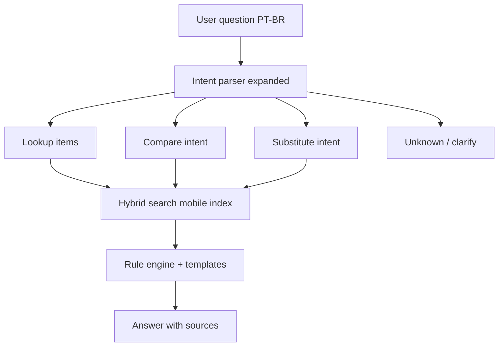

# Phase 8 — Mobile pack (≤200 MB, desktop capability parity)

> **Status:** ✅ Blocks A–G complete · **Parent:** [Phase 7](../07-app-integration/README.md) · [RAG V2 Phase D](../../docs/README-RAG-V2.md#phase-d--mobile-pack-200-mb)  
> **Goal:** Ship the **same user-facing capabilities** as the desktop NutriOffline assistant on common Android phones, with a **single on-device download capped at 200 MB**.

---

## Hard constraint

| Limit | Value |
|-------|-------|
| **Maximum pack size** | **200 MB** (embedder + index + routing; no separate LLM download) |
| **Target devices** | Mid-range phones — **6 GB RAM**, **64 GB storage** |
| **Network** | 100% offline after one-time download |

A 3B GGUF (~1.8 GB) **cannot** fit this budget. Capability parity is achieved by a **different architecture**, not by compressing the desktop LLM.

---

## Strategy — capability parity without on-device LLM

Desktop today has two paths:

| Path | Desktop | Mobile (Phase 8) |
|------|---------|------------------|
| Shorthand lookup | `intent_parser` → hybrid RAG → template | **Same** (port retrieval + formatter) |
| Full-sentence / compare | LLM + RAG (~3–14 s) | **Structured reasoning engine** — retrieve + compute + NL templates |
| Source priority (TACO > OFF) | `hybrid_search` + boost | **Same rules** in mobile index |
| Numeric grounding | `scale_nutrient()` in Python | **Same** — never model-generated numbers |



**Method:** Replace generative LLM reasoning with **deterministic retrieval + rule-based NLG** for the query types the desktop LLM currently handles. The desktop LLM path becomes **reference behaviour** for parity tests, not a runtime dependency.

See [MOBILE-CAPABILITY-MATRIX.md](../../docs/MOBILE-CAPABILITY-MATRIX.md) for query-type → implementation mapping.

---

## 200 MB budget model (enforced at build time)

| Component | Budget (MB) | Method |
|-----------|-------------|--------|
| Vector index (int8, 384-dim) | 90 | sqlite-vec; curated record set |
| Food metadata + FTS | 45 | SQLite: name, macros, source, id |
| Alias / keyword lexicon | 8 | Compact sqlite FTS5 |
| Embedder (ONNX int8) | 35 | `bge-small-en-v1.5` or `multilingual-e5-small` |
| Pack manifest + version | 2 | JSON + checksums |
| Headroom | 20 | Rebuild tuning |
| **Total** | **≤200** | CI gate fails if exceeded |

### Index scope (what fits in 200 MB)

| Tier | Records (est.) | Content | In base pack |
|------|----------------|---------|--------------|
| **A** | ~600 | TACO full | Yes |
| **B** | ~500 | TBCA complementary | Yes |
| **C** | ~8,000 | OFF Brazil — top branded / barcode frequency | Yes |
| **D** | ~98,000 | Remaining v1 scope | **No** — desktop only |

Tier D items are excluded from the mobile pack. Branded queries outside Tier C fall back to “not found” or keyword-only metadata if added later without vectors.

---

## Capability targets (parity with desktop)

| Capability | Desktop reference | Mobile acceptance |
|------------|-------------------|-------------------|
| `arroz 100g` | TACO 128 kcal, lookup p95 ≤800 ms | Same golden G1 |
| Multi-item totals | G3 | Same |
| Branded (`iogurte vigor`) | G5 within Tier C | Same when product in pack |
| Unknown food | G4 — no fabricated kcal | Same |
| “Quantas calorias tem 100g de arroz?” | LLM path (often wrong OFF) | **Must beat desktop** — route to lookup |
| “Frango vs ovo — mais proteína?” | LLM compare | Rule engine: retrieve both, compare field |
| Natural PT-BR tone | Fine-tuned LLM | Template NLG (deterministic) |
| Pack size | ~3 GB | **≤200 MB** |
| Latency p95 | lookup 186 ms | **≤500 ms** on mid-range CPU |

---

## Phase blocks

| Block | Focus | Est. |
|-------|-------|------|
| **A** | Capability matrix + budget spec | 2 days |
| **B** | Mobile index builder (sqlite-vec, int8) | 5–7 days |
| **C** | Tiny embedder ONNX export | 3 days |
| **D** | Intent expansion (NL → structured) | 5 days |
| **E** | Rule-based reasoning (compare, substitute) | 5 days |
| **F** | Pack builder + 200 MB gate | 2 days |
| **G** | Parity benchmark vs desktop | 3 days |
| **H** | Android runtime spike (optional) | 1–2 weeks |

**Total estimate:** 4–6 weeks part-time (Blocks A–G); Block H parallel to OpenFitness `:app`.

---

## Deliverables

```
nutri-offline/
├── docs/MOBILE-CAPABILITY-MATRIX.md
├── phases/08-mobile-pack/
│   ├── README.md          ← this file
│   └── TASKS.md
├── scripts/mobile/
│   ├── _paths.py
│   ├── pack_budget.py
│   ├── pack_schema.json
│   ├── select_mobile_records.py
│   ├── spike_sqlite_vec.py
│   ├── build_mobile_index.py      ← pending
│   ├── export_embedder_onnx.py    ← pending
│   ├── build_pack.py              ← pending
│   ├── reasoning_engine.py        ← pending
│   └── benchmark_mobile_parity.py ← pending
├── indexes/nutri-mobile/          ← gitignored artifact
│   ├── pack.manifest.json
│   └── nutri-mobile.pack          ← ≤200 MB
└── tests/
    ├── test_pack_budget.py
    ├── test_select_mobile_records.py
    ├── test_mobile_intent.py      ← pending
    ├── test_mobile_reasoning.py   ← pending
    └── test_mobile_parity_golden.py ← pending
```

Gate (repo root):

```bash
./scripts/validate-nutri-mobile-pack.sh
```

---

## Relationship to earlier phases

| Phase | Desktop | Phase 8 adaptation |
|-------|---------|-------------------|
| **3** RAG | LanceDB 448 MB, bge-m3 | Mobile index variant; desktop index unchanged |
| **5** Fine-tuning | QLoRA v1 adapter | **Not bundled** — templates mimic tone |
| **6** GGUF | llama-server 1.8 GB | **Not bundled** — reasoning engine replaces LLM |
| **7** App | CLI + FastAPI + optional LLM | Shared `intent_parser`, `lookup_orchestrator`; mobile mode flag |
| **RAG V2** | Phases A–C done | **Phase D** = this phase |

---

## Risks and mitigations

| Risk | Mitigation |
|------|------------|
| 200 MB too small for desired OFF coverage | Tier C curation by barcode frequency; expand only with optional pack v2 (explicit product decision) |
| NL sentences fail intent parse | Block D golden set 50+ utterances; iterative alias + pattern rules |
| Embedder quality drop vs bge-m3 | Parity benchmark on G1–G5 + 20 NL queries; rebuild index at 384-dim |
| “Same capabilities” disputed for open-ended chat | Document **supported query taxonomy** in capability matrix; unsupported → clarify prompt |

---

## Definition of done

- [x] `nutri-mobile.pack` builds and **≤200 MB** (CI gate) — **36.7 MB** artifact
- [x] Golden G1–G5 pass on mobile pack (Python reference runtime)
- [x] 20-query NL parity set ≥95% numeric accuracy vs desktop lookup path
- [x] Compare / substitute intents implemented without LLM
- [x] p95 latency ≤500 ms on reference mid-range profile (**10.9 ms** on dev CPU)
- [x] Phase docs + IMPLEMENTATION-PLAN updated
- [x] Android spike doc updated with pack integration steps

---

## References

- [MOBILE-CAPABILITY-MATRIX.md](../../docs/MOBILE-CAPABILITY-MATRIX.md)
- [android-integration.md](../../docs/android-integration.md)
- [README-RAG-V2.md](../../docs/README-RAG-V2.md)
- Desktop golden tests: `tests/test_lookup_golden.py`
